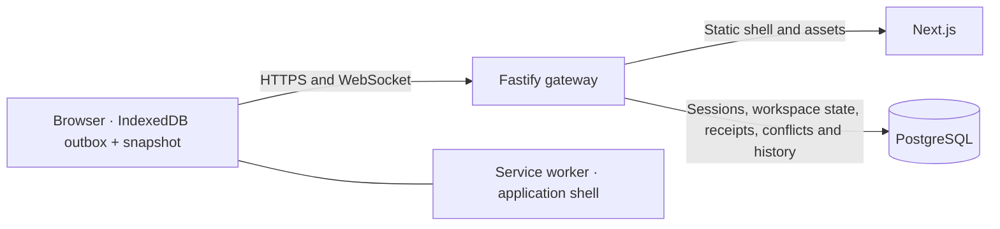

# Architecture

Fastify owns the public origin and proxies frontend routes to a loopback Next.js process. Auth cookies and actor headers are stripped from HTTP requests to Next.js. The gateway terminates business WebSockets. The production gateway disables frontend WebSocket proxying. PostgreSQL is authoritative. [Threat model and trust boundaries](threat-model.md)

## Write and recovery protocol

1. The browser commits a mutation to an IndexedDB transaction requesting strict durability before reporting it as queued. Outbox and snapshots are partitioned by user and workspace. The outbox has one slot per entity, enforced by a unique object-store key. Tabs share this queue and signal changes via BroadcastChannel. An open form keeps its draft and original task version while another tab's edit is pending.
2. The client fetches an authorized workspace snapshot before sending queued data. The actor header binds the request to the intended account. The transaction checks the active session and role using database row locks. Session deletion and membership changes therefore order against an in-flight write. A viewer can read, replay existing receipts, and dismiss their own conflict. New project and task mutations require an editor or admin.
3. The workspace row serializes mutations. The idempotency key is scoped by workspace, actor, and UUID. A matching retry replays the original receipt. Reusing the key for another payload returns HTTP 409. Task writes use the task version from the start of the edit.
4. On success, entity changes, workspace revision, activity, and receipt commit together. A failed receipt write rolls back everything. A conflict also advances the workspace revision and persists the actor's original proposal alongside the server version. A domain rejection persists a receipt without advancing workspace state.
5. An outbox entry is removed only in the same IndexedDB transaction that writes a snapshot at or beyond an authoritative receipt's revision. A locally cached acknowledgement alone cannot remove an entry. After interruption the browser replays the same mutation ID to revalidate that receipt. A failed snapshot cache write does not block submission of already queued work. If the browser cannot checkpoint, the queue remains available for retry.
6. WebSockets send invalidation hints after commit. The server verifies active membership and session before sending a hint, and rechecks idle sockets periodically. Private conflict transitions notify only the author. Clients also fetch snapshots on reconnect and a 10-second poll. A snapshot has its full checklist and up to 100 activity entries. Correctness does not require WebSocket delivery.

Existing projects accept offline task creations and edits. Offline project creation is supported, with task additions available after the project synchronizes.

## Conflict decisions

A stale edit receives a server version and keeps its original proposal. The server makes open proposals visible only to the originating actor, including in a clean browser profile. The user can compare title, completion, and assignee. **Keep server version** records an idempotent dismissal without editing the task or appending shared activity. **Use my edit** references the reviewed conflict and submits a fresh mutation against the displayed version. If the task advanced again, the decision produces a new conflict while closing the predecessor in the same transaction. The server accepts one decision per open proposal. An explicit decision from another device is reflected in the original outbox after reconciliation.

Run `npm run db:migrate` before upgrading the gateway. The migration is additive and retains the original results and fingerprints. A pre-audit conflict can still be resolved from its original browser queue. Its original proposal was stored only in that browser and cannot be reconstructed if that storage was already lost. Deploy the frontend and gateway together so the client and server agree on the snapshot format.

## Browser storage and offline access

The service worker obtains a static shell without credentials, extracts the hashed asset URLs from that same response, and caches the shell only after its assets are available. It never caches API requests. Online responses continue even when asset caching fails. IndexedDB data and the active account marker are local to the browser profile. The offline account must match the last verified login and its known expiry. On a verified 401 the browser hides the workspace and preserves that actor's queue for reauthentication. On a verified 403 it hides the denied workspace and stops transmission.

A malformed snapshot is replaced online. A structurally invalid outbox record stays in place and is reported while other records sync. An invalid receipt is eligible for replay with the original ID. Storage quota failure preserves an open form or an existing queue entry and surfaces an error. A user must retry failed form saves before leaving that page. Browser deletion or device loss can permanently remove edits that never reached the server. [Browser evidence and limits](demo.md)

## Remaining acceptance gates

- Verify the target HTTPS deployment, reverse-proxy timeouts, rate limits, cookie enforcement, and account recovery and provisioning.
- Establish backup and restore drills, migration rollbacks, session and receipt retention, health monitoring, and load budgets. Browser build assets currently have no automated retention policy.
- Full snapshots and per-workspace write serialization bound practical workspace size and throughput. WebSocket hints are instance-local. Replicas would rely on polling until a shared notification mechanism is added.
- Verify Firefox, Safari/WebKit, and physical field devices, including clock changes, long outages, and device-specific eviction. Use separate OS or browser profiles on shared devices. Sensitive deployments need device controls and an offline storage threat review.
- Account creation remains operator-driven. Invitation, workspace administration, full audit browsing, and cross-device recovery of writes that never reached the server are outside this slice.
