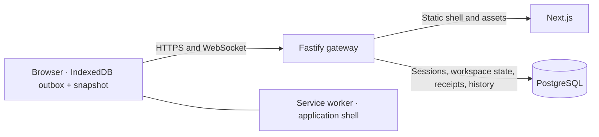

# Architecture

The Fastify gateway owns the public origin, including auth, the sync API, and WebSockets. It proxies frontend routes to a loopback Next.js process. PostgreSQL is authoritative. Deploy with TLS termination in front of the gateway and keep the raw gateway, Next.js, and PostgreSQL on trusted networks. Set `PUBLIC_ORIGIN` to the HTTPS origin. Local HTTP is supported only for loopback origins.

## Write and recovery protocol

1. The browser validates user input and commits the mutation to IndexedDB before showing it as queued. Outbox and snapshots are partitioned by user and workspace. Each task can have one outstanding edit. Users can also queue other independent changes while offline.
2. The client obtains an authorized workspace snapshot before sending its outbox. A client actor header binds the request to the intended account. The server checks it against the active session, then enforces workspace roles from PostgreSQL. Viewers can read. Admins and editors can mutate.
3. Each mutation carries a stable UUID and entity ID. Task updates also carry the version the user edited. The transaction locks the workspace row and checks for an existing receipt scoped by workspace, actor, and mutation ID. Matching retries return the saved receipt. Reusing the key for another payload returns HTTP 409.
4. On acceptance, entity changes, the next workspace revision, activity, and a receipt commit together. Conflict and domain-rejection receipts also commit durably. A retry can recover the exact result after a dropped response or gateway restart.
5. The browser stores the receipt locally. It removes successful outbox entries in the same IndexedDB transaction that persists a snapshot at or beyond their revision. Transport errors leave pending data available for retry. The service worker caches the static shell and build assets. Fetches for workspace data and mutations bypass that cache.
6. WebSockets send change hints after commit. Clients refetch a consistent database snapshot on hints, reconnect, and a 10-second poll. Snapshots include the full project checklist and up to 100 recent activity records. Recovery does not depend on receiving every WebSocket message.

Offline project creation is supported. A new project's tasks can be added after the project synchronizes. Existing projects can receive offline task creations and updates. Saving an open task form uses the version from when the form was opened, so receiving a newer version while typing cannot silently overwrite the other change.

## Conflict decisions

A stale edit receives a conflict receipt with the server task version. The browser saves the original proposal and the receipt across reloads and displays both titles, completion states, and assignees. **Keep server version** discards the local proposal. **Use my edit** creates a new mutation with a fresh ID, referencing the conflict and the version shown. If the server advances again, the new mutation conflicts again. Server history records successful explicit resolutions. Rejected writes retain their local proposal and error until the user discards it.

The server uses database foreign keys to constrain tasks to workspace projects and assignees to workspace members. Session tokens are random, stored as digests, and sent in HTTP-only, SameSite=Strict cookies with Secure and the `__Host-` prefix on HTTPS. Passwords use salted scrypt and login has an in-process rate limit. Write and WebSocket origins are checked against `PUBLIC_ORIGIN`. An authorized socket carries only invalidation hints and is revalidated every 15 seconds. Workspace reads recheck authorization on every fetch.

## Remaining acceptance gates

- Test HTTPS deployment behind the intended reverse proxy, proxy forwarding and timeouts, abuse controls, cookie enforcement in production browsers, and operations around account recovery and provisioning.
- Establish backup and restore drills, migrations across versions, session and receipt retention policy, health monitoring, load budgets, and replication strategy. Database rows and browser build assets currently have no automated retention policy.
- Full snapshots and per-workspace write serialization bound practical workspace size and throughput. Real-time hints are instance-local. Replicas would rely on polling until a shared notification mechanism is added.
- Run Safari/WebKit, Firefox, and physical field-device verification. Chromium was tested with two isolated contexts, including a 430px viewport. Test long outages, storage eviction, low disk space, and repeated interruption across device and database failures.
- Browser cache is local to the browser profile. It is accessible to someone with control of that profile, including across an offline interval after server-side access is revoked. Use separate OS or browser profiles on shared devices. IndexedDB is subject to browser eviction. Server records cannot recover a still-local edit after the browser loses storage. Plan managed devices or encrypted offline storage before using sensitive data in the field.
- Account creation is operator-driven. Invitation, account lifecycle, workspace management UI, export, and full audit browsing are outside this slice.
